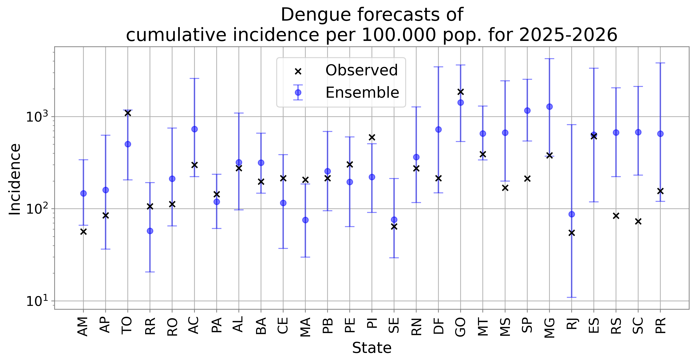
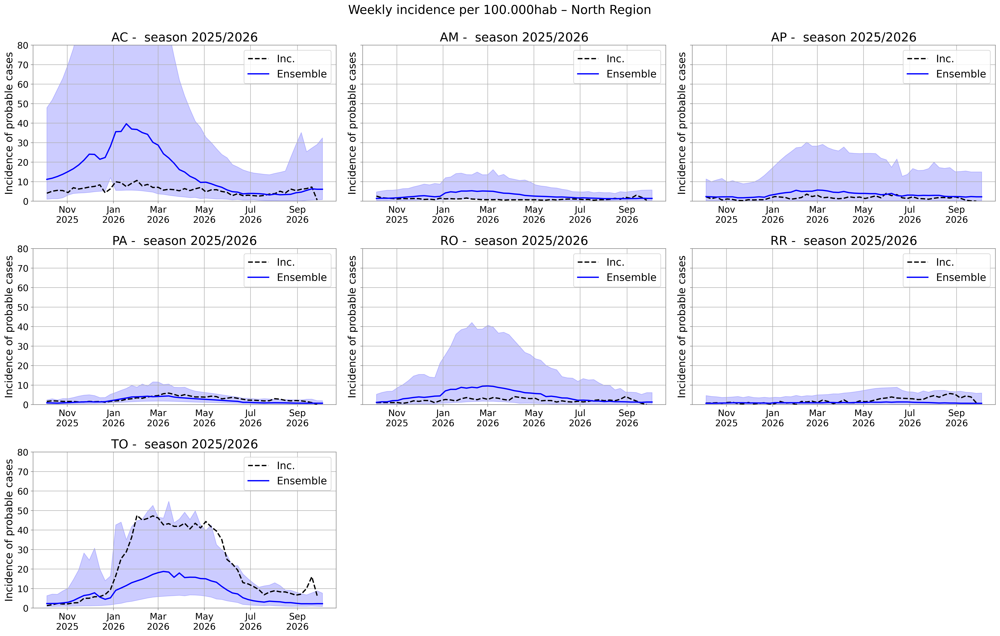
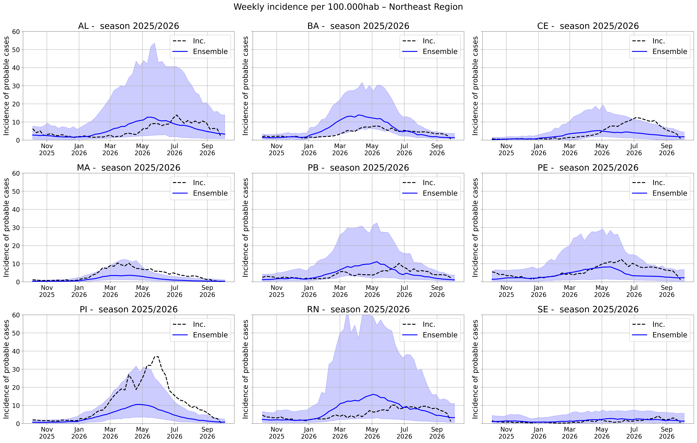
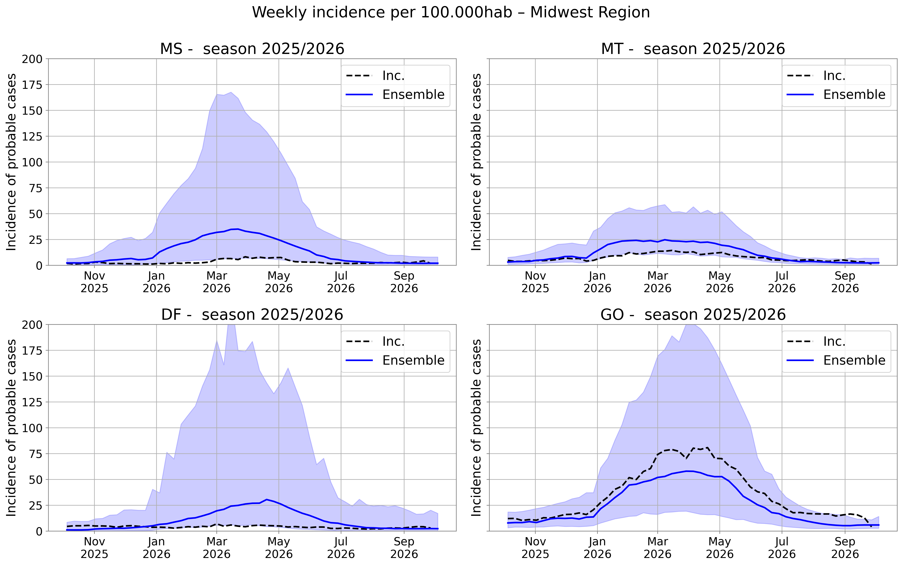
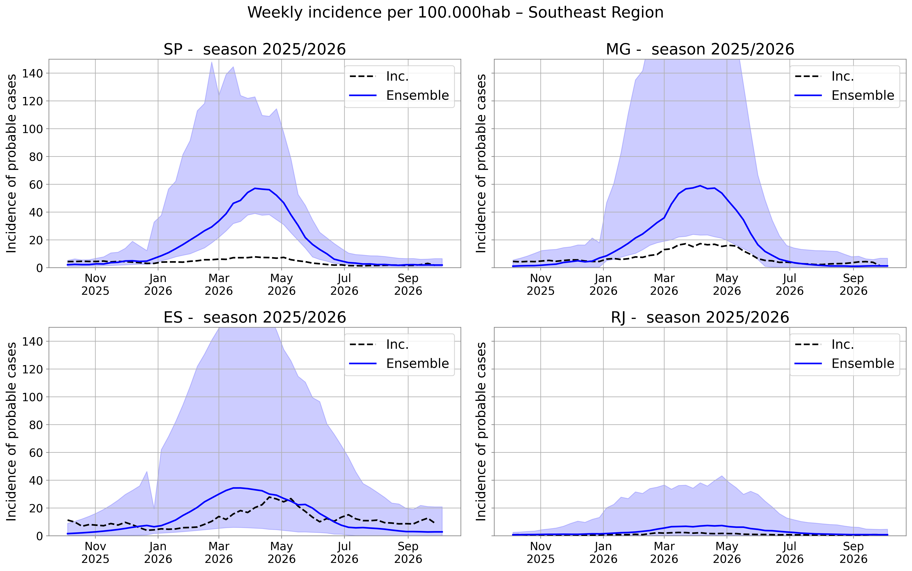
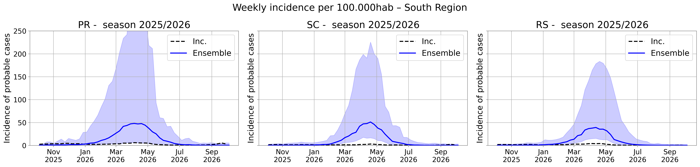

## Evaluation of Forecasts for the Previous Season (2025–2026)

This section compares the forecasts generated by the ensemble model developed for the challenge with the observed data from the 2025–2026 season. For further details on the ensemble methodology, see the [report](https://github.com/Mosqlimate-project/2nd_IMDC_sprint_results/blob/main/ensemble_results.md).

Figure 1 shows the ensemble estimates of cumulative dengue incidence by Brazilian state. Incidence is calculated as the total number of predicted cases divided by the state's population and multiplied by 100,000. The figure also presents the observed dengue incidence (marked with **×**).

In most states, the observed values fell within the uncertainty intervals of the ensemble predictions, indicating good coverage. However, in some states, the model overestimated the magnitude of the epidemics, particularly in São Paulo (SP), Santa Catarina (SC), and Rio Grande do Sul (RS).

In the Southern Region, there was a general tendency to overestimate the total number of cases, particularly in RS and SC, while the observed incidence in PR remained close to the lower bound of the uncertainty interval. This pattern may indicate a stabilization of dengue transmission in the region following a period of substantial expansion. In the Southeast, the estimates for RJ and ES were accurate, whereas the model tended to overestimate incidence in MG and SP.

In the Northeast, the model performed well in most states, with observed values falling within the predicted uncertainty intervals. The exceptions were MA and PI, where observed incidence exceeded the upper bounds of the predictions. In the North, the model also demonstrated good predictive performance, with incidence overestimated only in AM and underestimated in TO.

In the Central-West, the model generally tended to overestimate dengue incidence during the season. In GO, however, the estimate was accurate.

Overall, the results indicate good predictive performance of the ensemble model, as observed values remained within the uncertainty intervals in most states. Nevertheless, a tendency toward overestimation was identified in several states.

**Figure 1. Predicted cumulative dengue incidence (per 100,000 inhabitants) for the 2025–2026 season, by state.** Points and error bars represent the expected values and 90% uncertainty intervals of the ensemble predictions. The × symbols indicate the observed cumulative incidence during the 2025–2026 season.

### Analysis of Predicted and Observed Incidence Curves

The following figures present the weekly dengue incidence curves predicted by the ensemble model for each Brazilian state during the 2025–2026 season. They also show the observed incidence curves derived from epidemiological surveillance data, which remain subject to revision. To facilitate interpretation, the analyses are organized by geographic region.

#### Northern Region

The predicted incidence curves for each state in the Northern Region are presented in Figure 2. The forecasting model anticipated relatively low dengue incidence in most states, with higher numbers of cases expected in AC and TO. Indeed, the 2025–2026 season was generally mild across the Northern Region, including AC. Only in TO did the observed incidence exceed the model predictions.

**Figure 2. Predicted and observed dengue incidence curves in the Northern Region, 2025–2026.** The blue line represents the expected weekly incidence of probable dengue cases (per 100,000 inhabitants) in each state, according to the ensemble model. The shaded area represents the prediction uncertainty interval, while the dashed line indicates the observed incidence during the 2025–2026 season.

#### Northeastern Region

The forecasts for each state in the Northeastern Region are presented in Figure 3. Overall, relatively mild epidemic curves were expected, with higher peaks predicted in BA and RN. The observed incidence curves were generally close to those predicted, although their peaks occurred later than expected, particularly in CE, AL, PB, PE, and RN. The model showed poorer performance in PI, where observed incidence substantially exceeded the expected values, reaching the upper bound of the uncertainty interval.

**Figure 3. Predicted and observed dengue incidence curves in the Northeastern Region, 2025–2026.** The blue line represents the expected weekly incidence of probable dengue cases (per 100,000 inhabitants) in each state, according to the ensemble model. The shaded area represents the prediction uncertainty interval, while the dashed line indicates the observed incidence during the 2025–2026 season.

#### Central-Western Region

Compared with the Northern and Northeastern regions, the expected dengue incidence in the Central-Western Region was considerably higher (Figure 4), with predicted weekly incidence peaks exceeding 25 cases per 100,000 inhabitants. The predictions were also characterized by substantial uncertainty.

The observed incidence curves were lower than predicted in MS, MT, and DF, with values close to the lower bounds of the ensemble uncertainty intervals. In GO, however, the observed incidence initially followed the model predictions closely, subsequently diverging to values approximately 25% higher during the period of peak transmission.

**Figure 4. Predicted and observed dengue incidence curves in the Central-Western Region, 2025–2026.** The blue line represents the expected weekly incidence of probable dengue cases (per 100,000 inhabitants) in each state, according to the ensemble model. The shaded area represents the prediction uncertainty interval, while the dashed line indicates the observed incidence during the 2025–2026 season.

#### Southeastern Region

The incidence curves predicted by the ensemble model for the Southeastern Region, shown in Figure 5, indicated epidemic peaks exceeding 50 cases per 100,000 inhabitants in SP and MG, and 40 cases per 100,000 inhabitants in ES. Only RJ was expected to experience relatively low dengue incidence.

The observed data for the 2025–2026 season suggest that the ensemble model tended to overestimate incidence in all states except ES. In SP and MG, the anticipated epidemics did not materialize, and the observed incidence remained below the lower bounds of the ensemble uncertainty intervals.

**Figure 5. Predicted and observed dengue incidence curves in the Southeastern Region, 2025–2026.** The blue line represents the expected weekly incidence of probable dengue cases (per 100,000 inhabitants) in each state, according to the ensemble model. The shaded area represents the prediction uncertainty interval, while the dashed line indicates the observed incidence during the 2025–2026 season.

#### Southern Region

The forecasts for the Southern Region, presented in Figure 6, indicated substantial epidemic peaks in all states, particularly PR and SC, although the predictions were associated with considerable uncertainty. However, the observed epidemic curves were substantially lower than expected, indicating that the model overestimated weekly dengue incidence across the region.

**Figure 6. Predicted and observed dengue incidence curves in the Southern Region, 2025–2026.** The blue line represents the expected weekly incidence of probable dengue cases (per 100,000 inhabitants) in each state, according to the ensemble model. The shaded area represents the prediction uncertainty interval, while the dashed line indicates the observed incidence during the 2025–2026 season.

#### Summary

Forecasting models provide expected epidemiological scenarios that serve as reference points for assessing observed transmission patterns. During the 2025–2026 season, dengue incidence was lower than expected in most Brazilian states. These findings suggest that susceptible population depletion following several years of intense transmission may have contributed to reduced epidemic activity.

A temporal shift in dengue incidence was also observed in the Northeastern Region, where epidemic activity occurred later than predicted. This discrepancy represents an epidemiological anomaly that warrants further investigation. The region has been relatively spared from the major epidemic waves observed in recent years, highlighting the need for increased surveillance during the upcoming season. Furthermore, DENV-3 circulation has been documented in the region, with evidence of an increasing frequency of detection.
